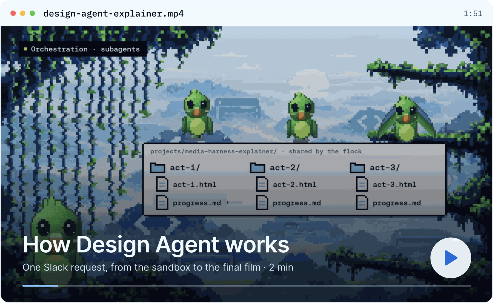

<div align="center">
  <p>
    <a href="https://www.langchain.com/">
      <picture>
        <source media="(prefers-color-scheme: dark)" srcset="https://github.com/langchain-ai/design-agent/raw/main/docs/assets/readme/logos/langchain-company-dark.svg">
        
      </picture>
    </a>
  </p>
  <picture>
    <source media="(prefers-color-scheme: dark)" srcset="https://github.com/langchain-ai/design-agent/raw/main/docs/assets/readme/header-dark.png">
    
  </picture>
  <p>
    <a href="LICENSE"><picture><source media="(prefers-color-scheme: dark)" srcset="https://shieldcn.dev/badge/license-Apache%202.0-7FC8FF.svg?variant=outline&logo=lu:Scale&mode=dark"></picture></a>
    <a href="https://www.python.org"><picture><source media="(prefers-color-scheme: dark)" srcset="https://shieldcn.dev/badge/python-3.11%2B-7FC8FF.svg?variant=outline&logo=python&mode=dark"></picture></a>
    <a href="https://github.com/langchain-ai/deepagents"><picture><source media="(prefers-color-scheme: dark)" srcset="https://shieldcn.dev/badge/built%20on-Deep%20Agents-7FC8FF.svg?variant=outline&logo=lu:Layers&mode=dark"></picture></a>
    <a href="https://docs.langchain.com/langsmith/python/managed-deep-agents-overview"><picture><source media="(prefers-color-scheme: dark)" srcset="https://shieldcn.dev/badge/deploy-Managed%20Deep%20Agents-7FC8FF.svg?variant=outline&logo=lu:Rocket&mode=dark"></picture></a>
  </p>
  <p>
    <b><a href="#see-it-work">▶ Watch the 2-minute film</a></b> ·
    <b><a href="#get-started">Get started in 5 minutes</a></b> ·
    <a href="docs/architecture/README.md">How it's built</a>
  </p>
</div>

**An open-source design agent: ask in Slack, get on-brand graphics, decks, diagrams and films
back.** It plans the piece, builds it on its own computer, checks it against your brand, and posts
the finished files to the thread.

We built it for ourselves at LangChain. Since August it has made about 3,000 assets for people
across the company, and three in four requests come from outside marketing.

## See it work

<p align="center">
  <a href="https://github.com/langchain-ai/design-agent/raw/main/docs/assets/readme/design-agent-explainer.mp4"></a>
</p>

<p align="center"><sub>One Slack request for a launch film: the plan, the storyboard, helpers rendering in parallel, the checks and the final cut.</sub></p>

| Without it | With Design Agent |
| --- | --- |
| Requests wait in the design queue | A graphic in a few minutes, a film overnight |
| The look every AI makes: a gradient, a centered title, glowing dots | Work that follows your brand, checked on every render |
| Everyone fixes the same mistakes again | Fix it once, and every asset after gets better |
| An agent on one person's laptop | One agent the whole company shares |

## Get started

Five minutes, no API keys. You need **Python 3.11+**, [uv](https://docs.astral.sh/uv/) and
**Docker**.

```bash
git clone https://github.com/langchain-ai/design-agent.git && cd design-agent
uv sync
uv run design-agent sandbox build
uv run design-agent demo
```

The demo runs the real agent, sandbox and checks with a scripted model, and leaves a launch card in
three sizes and a 4-second teaser in `workspace/out/demo/`. Then put `ANTHROPIC_API_KEY=…` in `.env`
and ask for something real:

```bash
uv run design-agent ask "A LinkedIn card announcing our design review service, 1200x627."
```

Files land in `workspace/out/<thread>/`, and the last line tells you what the run cost.

**Rather let your coding agent set it up?** Open Claude Code, Codex or Cursor in the repo and paste:

> Read AGENTS.md and .agents/skills/design-agent-onboarding/SKILL.md. Help me connect a model, add
> my brand, connect Paper, and choose a deployment path.

## Why it doesn't look like AI

- **It looks at its work.** It renders, then looks at the image before it posts anything.
- **Your brand is code.** Layouts only take your tokens: your colours, fonts and spacing.
- **It checks what a machine can count.** Colours, fonts, contrast, sizes and chart math are checked
  in code on every render. Taste stays with people.
- **Big pieces start cheap.** A film starts as a plan and a storyboard, and nothing renders until you
  say yes.

<p align="center">
  
</p>

## What you get

- **A lead agent that works for hours.** It plans, does small jobs itself, and hands long ones to
  helpers that work in parallel while you keep talking to it.
- **Its own computer for every thread,** with Chrome, FFmpeg, [HyperFrames](https://hyperframes.heygen.com),
  D2 and your fonts. Keys never go inside.
- **35 skills** for stills, decks, charts, diagrams, storyboards, motion, sound and thumbnails.
- **Your brand as a pack,** built for you from your brand guide, website, files or a Paper file.
- **A Slack app** with live progress, steering mid-job, and approval before anything goes public.
- **A shared canvas:** layouts and storyboards land in [Paper](https://paper.design) as editable
  layers.
- **Evals** built from real requests, so you can tell when a change makes it worse.

## Make it yours

| Want | Add | Guide |
| --- | --- | --- |
| Your brand | `workspace/brand/` (until then, a neutral sample brand) | [brand-onboarding skill](.agents/skills/brand-onboarding/SKILL.md) |
| Generated images | `OPENAI_API_KEY` | [Models](docs/models.md) |
| Voice, music, sound effects | `ELEVENLABS_API_KEY` | [sound skill](skills/sound/SKILL.md) |
| The Paper canvas | `PAPER_MODE=local` with Paper Desktop, or `bridged` when deployed | [Paper](docs/partners/paper.md) |
| Web search, your docs, other tools | MCP servers in `config/mcp.toml` | [Customization](docs/customization.md) |

Everything on this page uses LangChain's brand, because that's the one we run. Licensed fonts go in
`private-fonts/`, which Git ignores.

## Deploy it

| | Managed Deep Agents (recommended) | Self-hosted |
| --- | --- | --- |
| Start | `uv run design-agent sandbox publish`, then `uv run design-agent deploy` | `docker compose -f deploy/self-host/compose.yaml up -d --build` |
| Who runs it | LangSmith | you: the API, Postgres and a Docker host |
| Slack | a managed app you authorize | your own Slack app |
| Guide | [Deploy with MDA](docs/deploy-mda.md) | [Self-hosting](docs/self-hosting.md) |

`deploy` shows exactly what it will ship and asks first. `deploy --name design-agent-test` gives you
a separate copy to try changes on.

## Questions

**What does it cost?** The code is free (Apache 2.0). You pay your model provider: at LangChain a
typical graphic, slide or chart costs under $2 of model spend, and a 50-second launch film with
three cut-downs cost about $168. Managed Deep Agents [hosting is paid](https://www.langchain.com/pricing).

**Will it use my brand?** Yes. Add your brand pack and every file follows it. The
[brand-onboarding skill](.agents/skills/brand-onboarding/SKILL.md) builds the pack with you.

**Do I need Slack?** No. Use the terminal (`design-agent ask`), the self-hosted HTTP API, or a
deployment's API.

**Is it safe with my keys?** The sandbox never holds a credential and has no network by default.
Host tools do the fetching, generating and delivering, and drop results in as files.

**Which models?** Claude Opus 5.5 by default. OpenAI and Google models, any OpenAI-compatible
endpoint and the LangSmith Gateway work too. See [Models](docs/models.md).

**Does it replace a designer?** No. It makes the everyday asks fast and on-brand. Big pieces still
need someone directing them, and it's built to take notes.

## How it works

The model makes the creative calls. Code does everything that has to be exactly right: rendering,
measuring, checking, delivering files and holding your keys. It's built on the
[Deep Agents](https://github.com/langchain-ai/deepagents) harness and runs on
[Managed Deep Agents](https://docs.langchain.com/langsmith/python/managed-deep-agents-overview) or
your own infrastructure.

Read the [architecture](docs/architecture/README.md), or start changing it:
[instructions.md](instructions.md) · [skills/](skills/) · [Customization](docs/customization.md) ·
[Evals](docs/evals.md) · [Operations](OPERATIONS.md) · [Contributing](CONTRIBUTING.md).

**Ready?** [Get started](#get-started) in five minutes, or [watch the film](#see-it-work) first.

## Built with

<p>
  <a href="https://github.com/langchain-ai/deepagents"><picture><source media="(prefers-color-scheme: dark)" srcset="https://github.com/langchain-ai/design-agent/raw/main/docs/assets/readme/logos/deep-agents-dark.svg"></picture></a>
  &nbsp;&nbsp;
  <a href="https://docs.langchain.com/langsmith/python/managed-deep-agents-overview"><picture><source media="(prefers-color-scheme: dark)" srcset="https://github.com/langchain-ai/design-agent/raw/main/docs/assets/readme/logos/langsmith-deployment-dark.svg"></picture></a>
  &nbsp;&nbsp;
  <a href="https://hyperframes.heygen.com"><picture><source media="(prefers-color-scheme: dark)" srcset="https://raw.githubusercontent.com/heygen-com/hyperframes/main/docs/logo/dark.svg"></picture></a>
  &nbsp;&nbsp;
  <a href="https://paper.design"> <b>Paper</b></a>
</p>

Also: [LangSmith](https://smith.langchain.com) ·
[Chrome Headless Shell](https://developer.chrome.com/blog/chrome-headless-shell) ·
[FFmpeg](https://ffmpeg.org) · [D2](https://d2lang.com) · [Apache ECharts](https://echarts.apache.org) ·
[sharp](https://sharp.pixelplumbing.com). Logos belong to their owners. HyperFrames and Paper are
partner projects we build on.

---

[Apache 2.0](LICENSE) · [Notices](NOTICE.md) · [Changelog](CHANGELOG.md) · [Security](SECURITY.md) · [Code of conduct](CODE_OF_CONDUCT.md)
